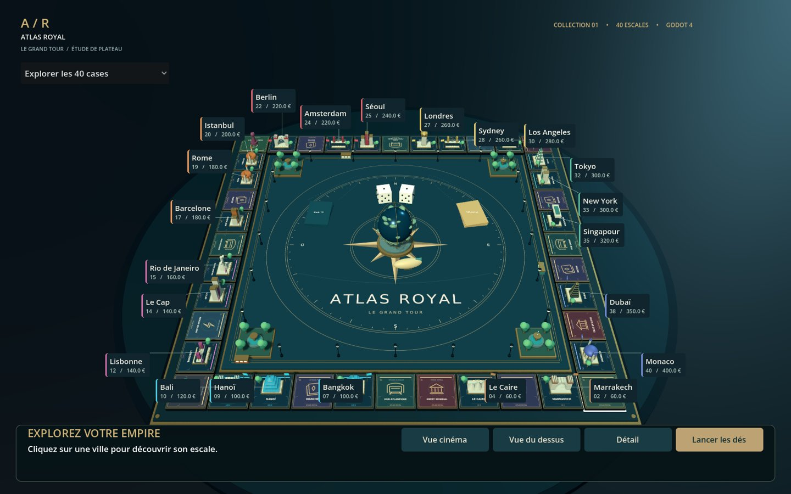
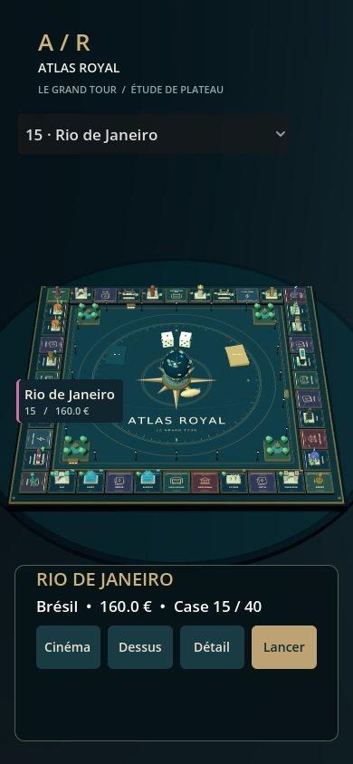

# ATLAS ROYAL — Le Grand Tour

Prototype visuel original sous **Godot 4.6**. Plateau 3D autonome avec les 40 cases du jeu Atlasroyal, 22 monuments stylisés, matériaux ivoire/laiton/vert profond, rose des vents, cartes et quatre pions.

## Ouvrir

1. Télécharger cette branche GitHub (Code → Download ZIP) et décompresser.
2. Dans Godot 4.6, importer `godot/project.godot`.
3. Appuyer sur **F6** depuis `main.tscn`, ou **F5** pour le projet.

Le décor est créé par `main.gd` à l'exécution : lancez la scène pour le voir. Aucun plugin, serveur ou téléchargement d'assets nécessaire.

## Commandes

- Bouton droit + glisser : tourner la caméra.
- Molette : zoomer.
- Clic gauche sur une case : nom, pays et prix.
- Espace / Lancer les dés : lancer animé et déplacement du pion doré.
- Vue cinéma : activer ou arrêter l'orbite automatique.
- Vue du dessus : observer le plateau en plan.
- R : rétablir la caméra initiale.

## Périmètre

Il s'agit du premier prototype de plateau demandé : aucun salon, backend, bot, achat ou règle économique n'est connecté. Les trois autres pions sont décoratifs. Les dés utilisent des valeurs aléatoires et des orientations correspondant à leurs faces ; l'animation est chorégraphiée, sans simulation physique.

Les monuments sont des miniatures procédurales stylisées inspirées des types du plateau, et non des reproductions architecturales exactes. Les cases sont importées de `src/engine/board.ts` ; `assets/board.json` constitue l'instantané utilisé par ce prototype.

## Structure

- `main.gd` : géométrie, matériaux, interface et interactions.
- `main.tscn` : scène principale.
- `assets/board.json` : 40 cases et données des villes.
- `smoke.gd` : vérifie la création du plateau et un déplacement complet.

Vérification sans interface : `godot --headless --path godot --script res://smoke.gd`.

## Lisibilité des villes

Les 22 noms de villes et leurs prix apparaissent dans des étiquettes 2D horizontales reliées aux cases. Leur taille reste constante à l’écran et leur disposition évite les chevauchements. Les monuments ne peuvent plus masquer les noms. Le test smoke vérifie les 22 étiquettes sur quatre angles de caméra à la taille de fenêtre par défaut.

## Plateau vivant et lisibilité

- Globe armillaire en rotation, dirigeable en orbite et trois tramways animés.
- Quatre jardins avec arbres et fontaines, lampadaires, drapeaux et vitrines éclairées.
- Les 22 villes utilisent des étiquettes horizontales avec traits de liaison ; noms et prix gardent leur taille à l’écran.
- En dessous de 1 100 pixels de largeur (ou 700 de hauteur), seule l’étiquette de la ville sélectionnée apparaît. Le menu « Explorer les 40 cases » donne accès à chaque nom complet et au détail de chaque case.
- Sur téléphone : glisser pour tourner et utiliser la liste pour sélectionner. Sur les appareils qui exposent les gestes de grossissement, le pincement permet le zoom.
- L’interface et les commandes se réorganisent en portrait. Le prototype n’est pas encore une application Android exportée.

## Sources vectorielles

- `assets/plateau-vectoriel.svg` : plateau complet de 40 cases, autonome et éditable, ouvrable dans un navigateur ou un éditeur SVG.
- `assets/centre-vectoriel.svg` : motif vectoriel central réellement utilisé dans la scène Godot.
- Les lettres SVG sont converties en tracés : aucun besoin d’installer la police. Licence des glyphes DejaVu incluse dans `assets/FONT-LICENSE.txt`.
- Le centre SVG est importé en texture 4 096 × 4 096 avec mipmaps et filtrage anisotrope. La source vectorielle peut être agrandie ; le rendu GPU reste une texture à résolution finie. Les bâtiments et pions restent de la géométrie 3D.

Les tests couvrent les noms sur quatre angles en 1 600 × 1 000, une disposition en 1 280 × 800 et une interface portrait en 390 × 844, ainsi que les animations et le déplacement. D’autres tailles et appareils peuvent nécessiter des ajustements.

## Cases redessinées

Les 40 cases utilisent désormais des dessins SVG individuels (`assets/cases/`) : fond encré, double filet doré, numéro, pays ou catégorie, illustration, titre et prix. Leurs couleurs et pictogrammes différencient les villes, cartes, transports, taxes, réseaux et jardins. Ces mêmes dessins sont intégrés dans le SVG du plateau complet.

Les miniatures 3D comportent des socles en pierre, corniches, fenêtres et silhouettes spécifiques : pyramides, portes à arcades, ponts à câbles, pagodes, tour horloge, tours étagées et jardins suspendus. Ce sont des interprétations stylisées, pas des modèles architecturaux exacts.

Sélectionnez une case par clic ou dans la liste, puis **Détail** pour rapprocher la caméra. **Vue du dessus** ou **R** rétablit une vue d’ensemble. Les noms restent dans les étiquettes de lecture, même lorsque la caméra tourne.
