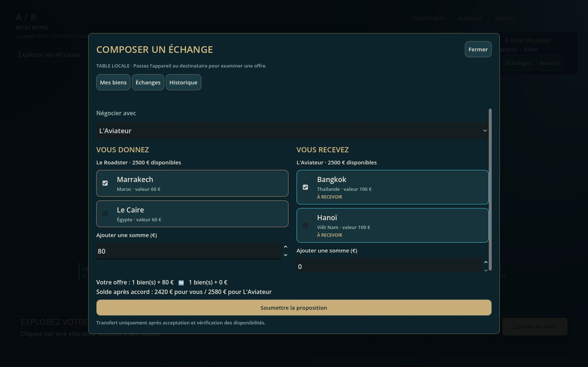
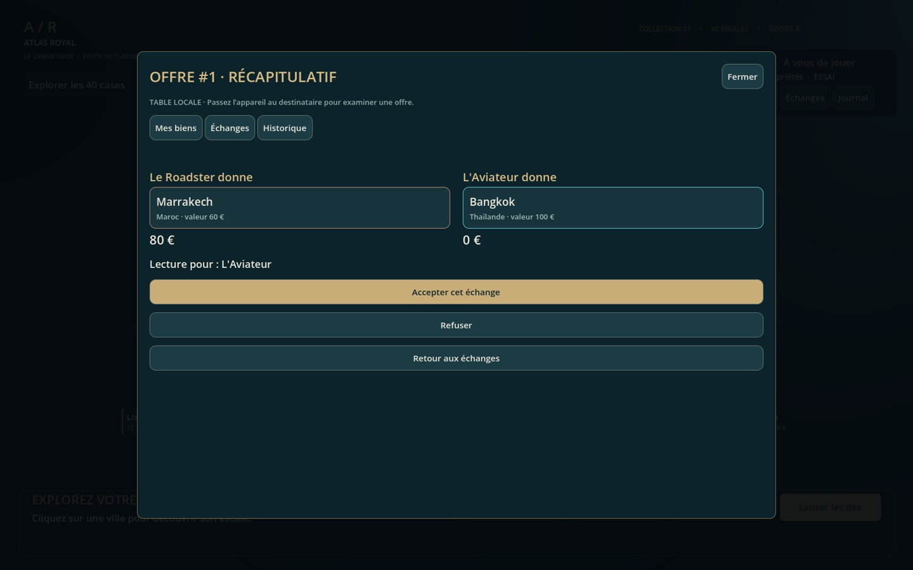
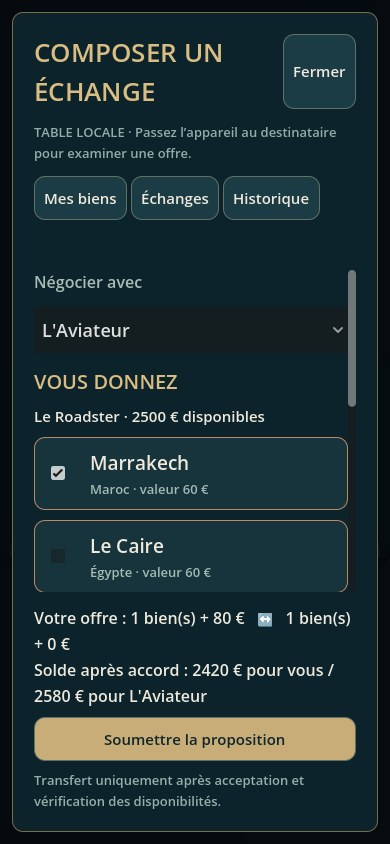
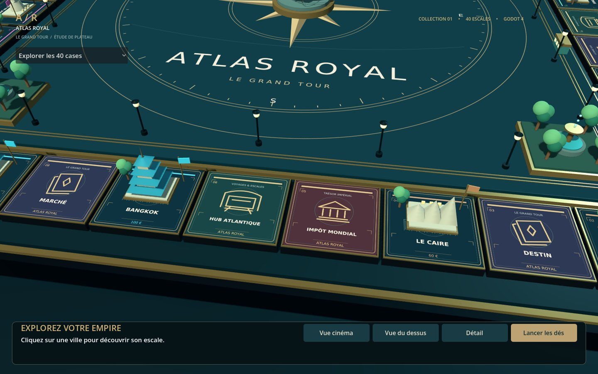

# ATLAS ROYAL — Le Grand Tour

Prototype autonome sous **Godot 4.6**, avec un plateau 3D de 40 cases et huit pièces originales.










## Ouvrir et jouer

Télécharger cette branche GitHub (Code → Download ZIP), décompresser et importer `godot/project.godot` dans Godot 4.6. Appuyer sur **F5**. Le décor est construit au lancement : lancer la scène pour le voir.

- Bouton droit + glisser : tourner la caméra ; molette : zoomer.
- Clic sur une case ou liste « Explorer les 40 cases » : sélectionner.
- **Détail** : rapprocher la caméra de la sélection.
- **Vue du dessus** ou **R** : revenir à une vue d’ensemble.
- **Lancer les dés** / Espace : lancer puis déplacer la pièce active. À l’arrivée, acheter une case libre ou négocier, puis **Terminer le tour** pour passer au joueur suivant.
- Les huit pièces jouent à tour de rôle sur le même appareil ; le bandeau indique la pièce et le tour suivant.
- Un anneau de couleur identifie la pièce active.
- Sur téléphone : glisser pour tourner ; sélectionner les cases dans la liste. Les gestes de grossissement permettent le zoom lorsqu’ils sont exposés par l’appareil.

## Les huit voyageurs

Chaque pièce possède sa propre géométrie, et non une simple variation de couleur :

1. **Le Roadster** : capot, cockpit, pare-brise, calandre, phares et roues.
2. **L’Aviateur** : biplan, entretoises, empennage et hélice animée.
3. **Le Voilier** : coque, pont, mât, bôme et deux voiles triangulaires.
4. **L’Express** : chaudière, cheminée, cabine, six roues et chasse-pierres.
5. **La Couronne** : huit pointes, perles, intérieur et pierres décoratives.
6. **L’Astrolabe** : cadran incliné, graduations, aiguille et anneaux.
7. **Le Cinéaste** : caméra sur pied, objectif, bobines perforées et manivelle.
8. **La Fusée** : corps fuselé, ogive, hublot, ailerons et poussée animée.

Les pièces ont un socle bas et une finition métallique. Elles commencent au départ dans des emplacements distincts.

## Déplacement

Le déplacement suit une courbe fermée passant par les 40 cases. L’interpolation adoucit les angles et une progression sinusoïdale produit l’accélération et le freinage. La pièce s’oriente selon la tangente, prend une légère inclinaison dans les virages et revient droite à l’arrêt. Le biplan et la fusée ont un léger soulèvement.

Les passages de cases sont comptés même lorsque la cadence baisse. À l’arrivée, les pièces partagent des emplacements distincts ; les doubles lancements sont bloqués. La durée ne dépend pas du nombre d’images affichées. Il s’agit d’une animation dirigée, pas d’une simulation physique avec collisions.

## Décor et dessins

- 40 dessins SVG individuels dans `assets/cases/` : fonds encrés, filets dorés, numéros, pays ou catégories, illustrations, titres et prix.
- Monuments miniatures stylisés : pyramides, arcades, ponts à câbles, pagodes, tour horloge et tours étagées.
- Globe tournant, dirigeable, tramways, jardins avec fontaines, arbres, lampadaires, vitrines et drapeaux animés.
- Noms de villes horizontaux avec traits de liaison ; disposition adaptée aux petits écrans avec liste de sélection.
- `assets/plateau-vectoriel.svg` : plateau vectoriel complet, avec les mêmes 40 dessins.
- `assets/centre-vectoriel.svg` : motif central utilisé dans Godot.

Les lettres SVG sont converties en tracés ; licence DejaVu dans `assets/FONT-LICENSE.txt`. Les SVG sont des sources vectorielles éditables ; leur rendu dans Godot passe par des textures à résolution finie, avec mipmaps et filtrage anisotrope. Les bâtiments et pièces sont de la géométrie 3D.

## Fichiers et vérifications

- `main.gd` : plateau, interface, décor et liaison aux pièces.
- `pawns.gd` : huit modèles, parcours, animation, placement et alternance des tours.
- `pawns_gallery.gd` : outil de capture des huit modèles.
- `pawns_test.gd` : tests de déplacement.
- `smoke.gd` : vérification du projet complet.

Depuis la racine du dépôt :

```bash
godot --headless --path godot --script res://smoke.gd
godot --headless --path godot --script res://pawns_test.gd
```

Tests : huit pièces distinctes, emplacements partagés, continuité du parcours, comptage exact au passage du départ, alternance de huit tours, tour complet, arrêt précis et blocage des lancements concurrents. Le test général couvre aussi les 40 cases, les étiquettes sur quatre angles, les interfaces 1600×1000, 1280×800 et 390×844, les animations et un lancer complet. Captures inspectées avec le rendu OpenGL de Godot 4.6.3.

## Périmètre

Il s’agit d’un prototype visuel interactif en local. Les achats simples et les échanges de propriétés/argent fonctionnent dans cette session locale. Les loyers, constructions, cartes, faillites, bots, salons et réseau ne sont pas encore connectés. La session reste en mémoire et repart de zéro à la fermeture du projet. Les huit pièces locales ne modifient pas la limite de joueurs du jeu web React existant. Aucun export Android ou PC autonome n’est inclus. D’autres appareils et tailles peuvent nécessiter des ajustements.

## Interface et échanges

Les boutons **Patrimoine**, **Échanges** et **Journal** ouvrent les écrans de gestion. Le patrimoine donne accès aux huit joueurs, aux soldes et à l’achat de la case d’arrivée. Le journal retrace lancers, arrivées, achats et échanges. Un repère coloré sur les cases indique le propriétaire.

Dans **Échanges → Composer un échange**, choisir un partenaire, cocher les propriétés de chaque côté et ajouter éventuellement une somme. Le récapitulatif et le bouton de proposition restent visibles pendant le défilement. Une proposition ne transfère rien. Le destinataire examine le récapitulatif sur le même appareil, puis accepte ou refuse ; l’auteur peut retirer son offre.

À l’acceptation, l’autorité locale revérifie les propriétaires et les deux soldes, puis effectue tous les transferts ensemble. Une offre périmée expire sans transfert partiel. Les propositions sans contrepartie, doublons et montants négatifs sont refusés. Aucune connexion réseau ni authentification distante n’est simulée.

Pour tester immédiatement : **Patrimoine → Démarrer une partie d’essai locale** distribue deux villes à chacun. Cette option est indisponible après le premier achat ou la première offre. Les captures des écrans d’échange utilisent cette partie d’essai.

La caméra accompagne les déplacements en douceur et revient ensuite à la vue choisie. La pièce garde son tour à l’arrivée jusqu’à **Terminer le tour**.

Tests supplémentaires :

```bash
godot --headless --path godot --script res://trade_test.gd
godot --headless --path godot --script res://trade_ui_test.gd
```

Ils couvrent l’achat, les prix des hubs et réseaux, l’absence de transfert à la proposition, les droits des participants, les offres périmées, l’insuffisance de fonds, la conservation des sommes échangées et l’exécution unique. Le test d’interface vérifie un échange réel, les repères de propriété, les vues 1600×1000 et 390×844 ainsi que la fin de tour explicite.
