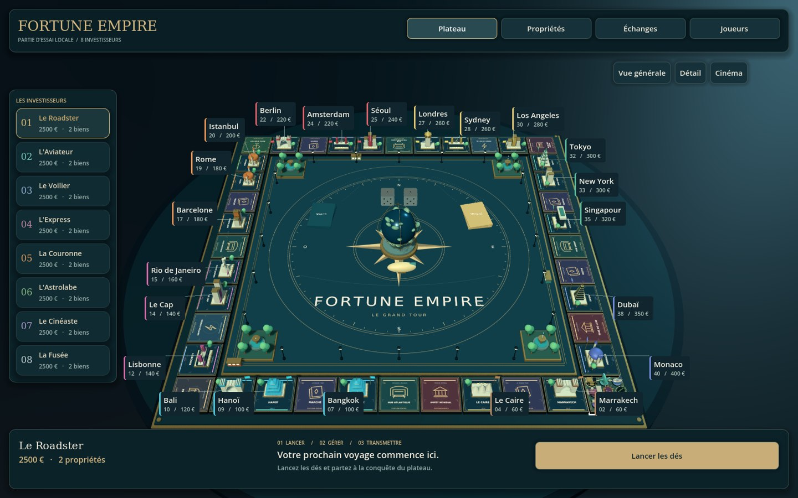
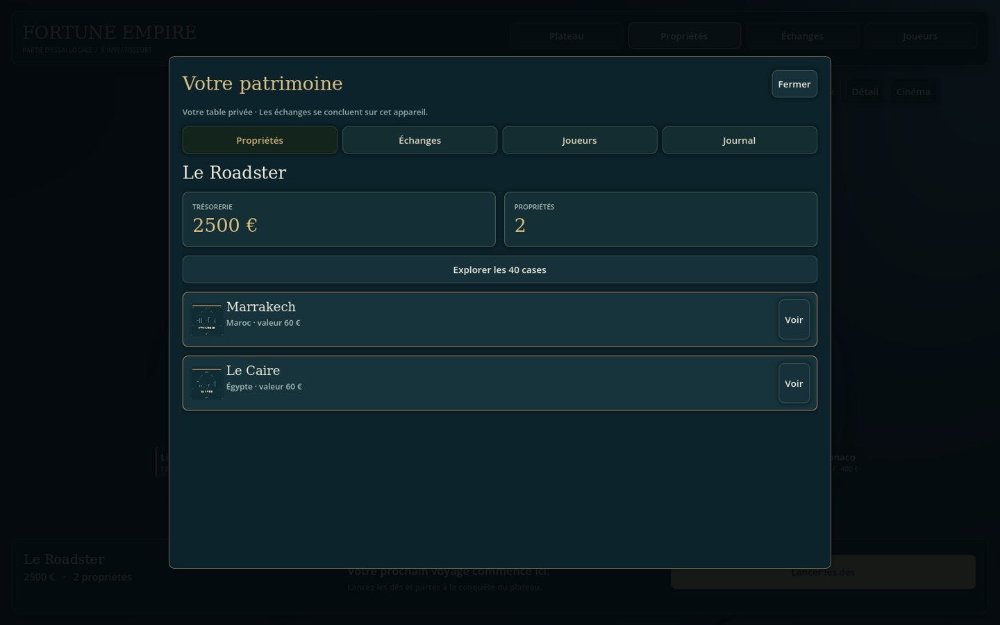
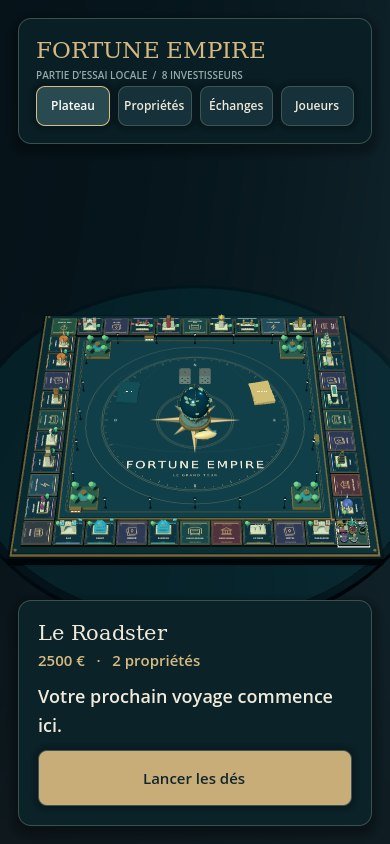
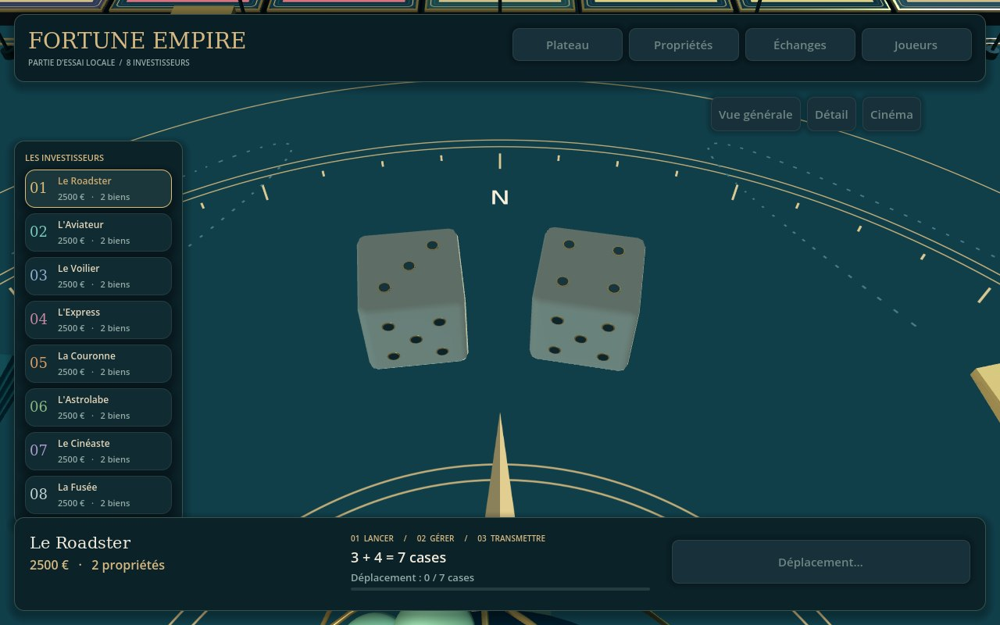
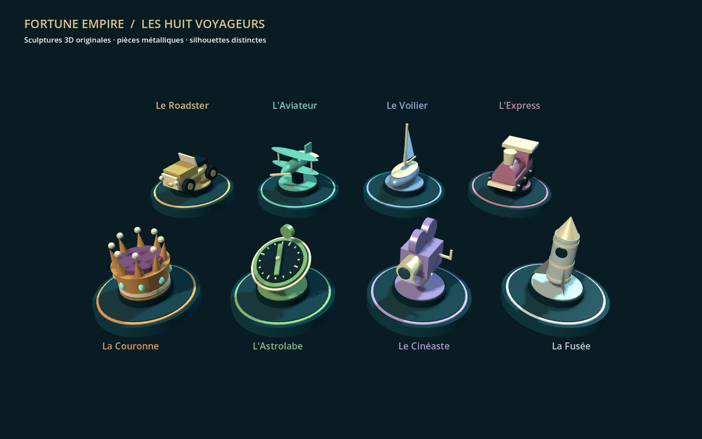

# Fortune Empire

Un plateau de jeu 3D original sous **Godot 4.6**, avec huit pièces distinctes, une interface de gestion locale et des échanges fonctionnels.



[Voir une capture réelle du lancer et du déplacement : 3 + 4 = 7 cases](fortune-movement.mp4)

## Ouvrir

Télécharger cette branche (Code → Download ZIP), décompresser, puis importer `godot/project.godot` dans Godot 4.6. Appuyer sur **F5**. Le décor est généré au lancement.

## Une interface pour toute la partie

- **Plateau** : revenir à la vue générale.
- **Propriétés** : consulter la trésorerie, les biens possédés et les 40 escales ; acheter une case libre à l’arrivée.
- **Échanges** : propositions reçues et envoyées, récapitulatifs, acceptation, refus, retrait et contre-propositions.
- **Joueurs** : consulter les huit investisseurs et lancer une négociation.
- **Journal** : retrouver les lancers, arrivées, achats et accords.

La colonne des investisseurs apparaît sur ordinateur. Sur téléphone, la navigation reste en haut et la commande du tour en bas, sans colonne latérale. Les cartes de propriété utilisent les dessins du plateau ; les titres emploient une police intégrée au projet. Les fenêtres ont un léger fondu, des états de sélection et une navigation clavier visible. Échap ferme une fenêtre.





## Dés et déplacements

**Lancer les dés** déclenche une transition de caméra vers les deux dés, puis le lancer, les rebonds et l’arrêt. Les dés ont une géométrie arrondie et des points sombres cerclés de laiton. Les faces visibles sont calculées à partir des valeurs retenues. Le résultat affiché est relu sur les deux faces supérieures et son total sert au déplacement.

La caméra suit ensuite la pièce et le compteur indique les cases parcourues. À l’arrivée, la caméra revient à la vue choisie. La gestion reste au joueur courant jusqu’à **Terminer mon tour**. Les doubles clics/lancements sont bloqués pendant l’animation.



Les huit pièces ont une géométrie propre : roadster, biplan, voilier, locomotive, couronne, astrolabe, caméra de cinéma et fusée. Le déplacement suit une courbe continue avec anticipation, accélération, orientation tangentielle, inclinaison dans les virages, freinage et mise au repos. Le roadster a des roues qui tournent et des roues avant orientables ; le voilier prend du roulis ; le biplan incline sa trajectoire et fait tourner son hélice ; la locomotive fait tourner ses roues ; la fusée se soulève avec une flamme animée. Les autres pièces ont une animation plus discrète adaptée à leur forme.



À l’arrivée, plusieurs pièces sur une même case se répartissent dans des emplacements distincts. Il s’agit d’animations dirigées, et non d’une simulation physique avec collisions. Les sons de contact des dés se coupent dans **Joueurs**.

## Échanges entre les joueurs

Choisir un partenaire, cocher les propriétés de chaque côté et ajouter éventuellement de l’argent. Le récapitulatif et la commande d’envoi restent visibles pendant le défilement. La proposition ne transfère rien.

Le destinataire examine l’offre sur le même appareil, puis l’accepte, la refuse ou prépare une contre-proposition. L’auteur peut retirer son offre. Une contre-proposition valide remplace l’offre initiale, qui ne peut alors plus être acceptée.

Avant l’acceptation, l’autorité locale revérifie les propriétaires, les contreparties et les deux soldes. Les titres et l’argent sont transférés ensemble. Une offre périmée expire sans transfert partiel ; les doublons, montants négatifs et propositions sans contrepartie sont refusés.


Pour essayer immédiatement : **Propriétés → Démarrer une partie d’essai locale** attribue deux villes à chacun. Cette option n’est plus disponible après le premier achat ou la première offre. Les captures de gestion utilisent cette partie d’essai, signalée dans l’en-tête.

## Commandes de caméra

Bouton droit + glisser : tourner. Molette : zoomer. Sur téléphone : glisser pour tourner ; les gestes de grossissement permettent le zoom quand l’appareil les expose. Clic sur une case, puis **Détail** : examiner. Dans **Propriétés → Explorer les 40 cases**, **Voir** ouvre également un gros plan. **Plateau**, **Vue générale** ou **R** rétablit une vue d’ensemble. **Cinéma** active ou arrête l’orbite. Espace lance les dés ou termine le tour selon la phase.

## Dessins et décor

40 cases SVG individuelles (`assets/cases/`) avec cadres dorés, titres en tracés, pictogrammes, numéros, pays et prix. Monuments miniatures stylisés, jardins, fontaines, lampadaires, globe tournant, dirigeable, tramways et drapeaux animés.

- `assets/plateau-vectoriel.svg` : plateau vectoriel complet.
- `assets/centre-vectoriel.svg` : motif central utilisé dans la scène.
- `assets/ui/EmpireSerif.ttf` : police de titres intégrée, sous-ensemble DejaVu Serif.
- `assets/FONT-LICENSE.txt` : licence des polices et glyphes.

Les SVG sont des sources éditables ; Godot les importe en textures à résolution finie, avec mipmaps et filtrage anisotrope. Les bâtiments, pièces et dés sont de la géométrie 3D. Les monuments sont des interprétations stylisées.

## Vérifications

Depuis la racine du dépôt :

```bash
godot --headless --path godot --script res://smoke.gd
godot --headless --path godot --script res://premium_ui_test.gd
godot --headless --path godot --script res://pawns_test.gd
godot --headless --path godot --script res://dice_test.gd
godot --headless --path godot --script res://trade_test.gd
godot --headless --path godot --script res://trade_ui_test.gd
```

Les tests couvrent les 36 combinaisons de dés (faces visibles et nombre exact de cases), la continuité du parcours et son bouclage, huit tours, le placement partagé et l’arrêt précis. Ils vérifient aussi les achats et échanges, les contre-propositions, les offres périmées, les droits des participants, la conservation des sommes et l’exécution unique. Les tests d’interface couvrent les vues ordinateur et portrait, l’absence de débordement, la navigation et l’action principale de tour. Captures inspectées avec le rendu OpenGL de Godot 4.6.3.

## Périmètre actuel

Session locale sur un seul appareil, conservée en mémoire seulement. Elle repart de zéro à la fermeture. Achats simples et échanges fonctionnent ; maisons, hôtels, loyers, cartes, faillites, bots, sauvegarde et réseau ne sont pas encore connectés. Aucun export autonome PC ou Android n’est inclus. Le moteur React du dépôt n’est pas remplacé et sa limite de joueurs reste indépendante de ce prototype. D’autres appareils peuvent demander des ajustements.
